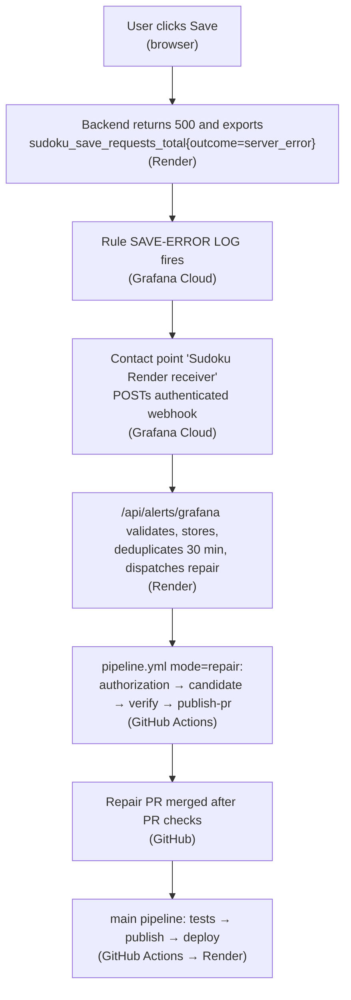

# Application Architecture

## Agreed Decisions

- `frontend/`: React, TypeScript, and Vite, with a desktop dark theme.
- `backend/`: Python and FastAPI.
- `database/`: database migrations, initialization/seed assets, and three verified
  easy puzzles. Do not store credentials or live database files in Git.
- PostgreSQL for persistent data.
- A new, dedicated Render PostgreSQL instance for Sudoku development, separate
  from Kanban storage. A separate external provider such as Neon is not selected.
- Separate frontend and backend Docker images and separate Render Web Services
  deploying those images, following the existing Kanban project's image-based
  approach. The frontend is not deployed as a Render Static Site in this design.
- The frontend image serves the built static assets through a web server.
- Render uses free default addresses; no custom domain is available.
- Development environment only for the initial delivery, with separate frontend
  and backend Render Web Services. Production is deferred.

## Containers and Local Startup

Provide a Dockerfile for each application service and Docker Compose for the full
local system: frontend, backend, and PostgreSQL.

The intended startup command from the repository root is:

```sh
docker compose up --build
```

The local setup must not depend on an external hosted database or manual SQL
steps. Compose must coordinate database readiness, migrations, and idempotent
puzzle seeding before the API becomes ready. PostgreSQL uses a named volume so
ordinary container recreation preserves saved games. Document first-run setup
and any required configuration without committing secrets.

`compose.prod.yaml` builds production images with isolated PostgreSQL and
publishes only the frontend on port 18080 (`PROD_FRONTEND_PORT` may override).
Its local HTTP-only production smoke service explicitly disables Secure cookies;
Render HTTPS must keep them enabled.

The frontend Nginx container serves React and proxies same-origin `/api/`
requests to `API_UPSTREAM`; Compose uses `http://backend:8000`. Nginx listens on
`PORT` (80 locally, Render's configured service port remotely). The browser does
not require permissive CORS or cross-site cookies. Backend and PostgreSQL are
not published on host ports. HTTPS upstreams use verified CA trust, Host and SNI;
local HTTP remains supported.

## Render Deployment

Build versioned frontend/backend images, paired by full commit SHA and immutable
digests. GHCR is the selected registry, with public packages so Render does not
need registry credentials. Render pulls images rather than rebuilding source.
Keep the existing exact-digest Render API deployment mechanism, not deploy hooks.
Render PostgreSQL supplies managed persistence; an ephemeral container filesystem
is not a substitute. Never use Kanban's database or credentials.

The original #11 order is local production-image verification (#16), manual owner
GHCR publication/Render setup, then deployed verification (#13). The later #12
approval permits pipeline implementation before #13, not removal of deployed
verification. Normal PR/main tests gate main publication; opt-in development CD
requires both existing owner flags and #13 evidence. Two application Web Services
and a dedicated Sudoku database are the only initial deployment targets.

Record the exact backend/frontend digests, verify login, puzzle loading,
save/resume and the expected version, and retain a compatible healthy pair.
Image rollback does not undo migrations. Never downgrade schema or rewrite
player data for rollback. See [Render runbook](runbooks/render-development.md)
and [pipeline runbook](runbooks/pipeline.md).

Production services/promotion are deferred. If later introduced, isolate data,
credentials and configuration and promote the exact verified pair without
rebuilding. No current rubric claim of production delivery is justified.

## Test Entry Point

The repository-root command is `sh scripts/test.sh`. It runs backend rules,
configuration, security/API, migrations and persistence tests against a fresh
real PostgreSQL container, plus frontend interaction tests, TypeScript checks,
and a production Vite build. The test database is tmpfs-backed in a unique test
Compose project and is never the named developer application volume. Any setup,
migration, seed, test, frontend, or build failure propagates as a nonzero command
result. See `compose.test.yaml` and `docs/adr/0001-core-implementation-decisions.md`.

Tests cover Sudoku rules, immutable clues, authorization, CSRF, logout/revocation,
invalid boards and completed-game immutability; exact persistence/reopen;
idempotent migrations/seeds; configuration/PORT/DATABASE_URL/Secure-cookie
handling; frontend interactions; and isolated HTTP/HTTPS proxy regressions.
Pipeline/repair failures and authorization gates use offline mocks, never live
Render or model calls. Test cleanup deletes only its own disposable resources.
Local results do not demonstrate remote CI, Render setup or deployment success.

## Observability

The owner approved logs, metrics and traces using the Kanban approach on
26 October 2026. Issue #15 supplies the independent opt-in local stack:
OpenTelemetry Collector, Prometheus, Loki, Tempo and authenticated Grafana.
Telemetry persists in its own volumes. Public anonymous access is not allowed;
host-published interfaces bind to localhost and ingestion stays on the private
Compose network.

Saving a game is the key traced journey: frontend trace context crosses Nginx,
the API save span and its database child span. Structured logs carry trace/span
IDs, service, environment, version, operation and outcome. Metrics have finite
method/route/status/outcome labels, never trace IDs or player IDs. Dashboard
views distinguish expected 4xx from server errors and show rates, latency and
save outcomes. Metric exemplars link to traces; trace-ID-filtered log links pad
time by one minute each side. Capture dashboard, trace, DB child and correlated
log evidence independently.

Never record usernames, passwords/hashes, session/CSRF tokens, cookies, database
credentials, request bodies or boards. Exporter outages must not break saves;
failures remain visible with sanitized diagnostics.

Issue #17 adds explicit authenticated HTTPS OTLP `http/protobuf` export for all
three signals using standard endpoint/header variables. Local HTTP traces/logs
and gRPC metrics remain the default. The owner privately configures destinations
and verifies remote ingestion, retention and current free-tier limits. No local
test claims remote Grafana collection/correlation. Do not expose the local stack
to receive internet traffic.

## Approved bounded save recovery — #20 replacement

The [replacement specification](specs/issue-20-replacement.md) records the exact
user approval at **2026-10-28T09:39:20Z, “approved do it”**, the baseline and
criteria #20-R1..R8. This supersedes operational fault/demo controls and
manual-only merge from earlier #18/#19/#20 designs, not SUD-01..14. Earlier
approvals/evidence remain historical in the issues and Git history.

### How the flow works (overview)

Descriptive summary only; the numbered requirements below and the
[replacement specification](specs/issue-20-replacement.md) remain authoritative.



1. **Save fails (Render).** A user clicks Save; the backend answers 500 and
   counts it in `sudoku_save_requests_total{outcome="server_error"}`, which is
   exported to Grafana Cloud.
2. **Alert fires (Grafana Cloud).** The rule **SAVE-ERROR LOG** fires and the
   contact point **Sudoku Render receiver** POSTs an authenticated webhook to
   `https://simple-sudoku-backend.onrender.com/api/alerts/grafana`.
3. **Receiver checks and records (Render).** The backend accepts only one firing
   alert with labels `alertname`, `operation=save_game`, `service=sudoku-api`,
   `severity=warning` and a positive value. It stores a deduplicated incident
   (30 minutes) and dispatches `pipeline.yml` in `repair` mode.
4. **Authorization and candidate (GitHub Actions).** The `authorization` job
   claims the incident via signed OIDC at `/api/alerts/repair/claim` (single use
   per alert). The `candidate` job runs the pinned Copilot CLI
   `Prj_Coordinator` in an isolated container to produce the fix.
5. **Verify and publish (GitHub Actions).** `verify` runs the full tests plus
   independent QA and Reviewer sessions; `publish-pr` opens the repair PR and
   requests auto-merge after the ordinary PR checks.
6. **Merge and deploy (GitHub Actions → Render).** After merge, the normal main
   pipeline runs tests → publish → deploy to Render.

The healthy save handler is restored as maintenance. Migrations 0001..0004,
existing historical control tables/columns and account/game data remain intact;
obsolete demo model mappings are no longer used. No new schema migration,
runtime fault switch, arm/revoke endpoint, revision-pair requirement or
failed-test deployment exception remains.

1. Grafana's existing **SAVE-ERROR LOG** rule should route its authenticated
   webhook to the development backend. A positive finite save-server-error
   evaluation, fixed labels and one firing alert are required. No-data/query
   errors, resolved alerts, other operations and expected 4xx do not qualify.
   The receiver and signed-OIDC claim route alone are exempt from cookie CSRF.
2. PostgreSQL stores the hashed fingerprint and bounded incident lifecycle, not
   payloads. Transaction locking, uniqueness, global rate limiting, 30-minute
   deduplication/TTL, lease and at most three bounded dispatch attempts remain.
   ACK follows commit. The master `ALERT_REPAIR_ENABLED` kill switch defaults
   off. The backend cannot receive an alert while it is down.
3. Only this repository's main `pipeline.yml` repair dispatch is accepted.
   GitHub-signed OIDC verifies issuer/audience/repository/ref/event/workflow and
   binds an incident to one run/attempt. Replays/fabricated/expired incidents
   fail closed. Downstream outputs/artifacts are attempt-bound; fresh server
   verification precedes tests and publication. Claim requests and JWKS
   retrieval use fixed HTTPS destinations, no redirects/ambient proxies,
   bounded bodies/timeouts/deadlines and a bounded locked public-key cache.
4. One pinned Copilot CLI candidate invocation uses the existing coordinator
   and declared Dev/QA/Reviewer agent definitions. The isolated non-root,
   resource-limited read-only-root container receives only its read/Copilot
   token, never DB/Render/OIDC/PR credentials, host home or Docker socket.
   Instructions are read-only. Source and an opaque incident are the sanitized
   context; no raw alert/log/request/board content is sent.
5. Only the exact save-handler typo correction is accepted; unsupported faults
   or absent/changed pinned regression fail closed. The runner validates rather
   than generates the patch. A separate job tests the exact candidate with the
   unchanged full harness, including exact persistence/reopen and rollback.
   Distinct read-only QA/Reviewer sessions bind PASS to the same patch,
   revision and executed test receipt. No candidate code executes in the
   credentialed publisher.
6. Publication checks exact tested tree and unchanged main, opens a temporary
   repair PR and requests automatic merge **after ordinary PR checks** with an
   exact-head match. Branch protection and review/permission requirements are
   never bypassed; unavailable auto-merge settings/permissions stop safely
   without remote configuration changes. Merge then uses ordinary CI/CD.
7. Entitlement/quota remain unknown here. Existing verified-access or explicit
   one-attempt accepted-access-risk consent does not enforce provider billing.
   No-paid/no-overage and transmission approvals remain mandatory; no smoke,
   provider probe, retry loop or paid usage enablement is allowed. Runtime
   stages share a maximum 15-minute server claim deadline. The operator's
   earlier 15-minute timer starts at any separately confirmed future fault
   deployment and requires healthy restoration on failure/timeout. See the
   [operator runbook](runbooks/development-save-demo.md).

No live change, provider call, Actions dispatch or fault deployment is authorized
in this cleanup. After local tests and current independent QA/review PASS, only
the coordinator may commit/push/deploy the healthy version to existing Render
development services. A future fault needs separate confirmation and manual image
build outside normal test-gated CI, never another pipeline. An image-only fault
with healthy main has no honest source fix PR; future provenance must be resolved
with the owner before that exercise.

## Remaining Operational Decisions and Follow-up

- Confirm dedicated Render PostgreSQL availability, region and export plan.
  Documented Free limits are one active database per workspace, 1 GB, 30-day
  expiry and no managed backups. Do not delete/modify Kanban to make room.
- Confirm compute-plan/budget choices before provisioning. Free Render services
  cannot receive private-network requests; use the backend public HTTPS upstream
  if necessary, with the browser still using the same-origin frontend proxy.
- #13 must independently verify deployed cookies/CSRF, login, exact save/reopen,
  restart persistence, image identities and compatible healthy restoration.
- #12 remote CI/CD and #18/#19/#20 alert/repair evidence remain separate from
  local test results. Actual Grafana route/delivery, no-paid controls and
  auto-merge permission/settings have not been verified by this cleanup.
- Secure telemetry destinations, retention and hosting/free-tier limits need
  operator evidence. Broader alerts, production and unrestricted remediation
  remain out of scope. Do not close #20 before renewed QA/review and live evidence.
